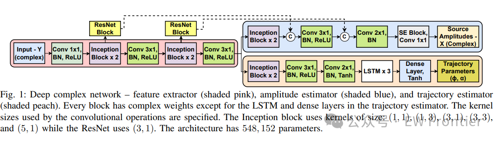
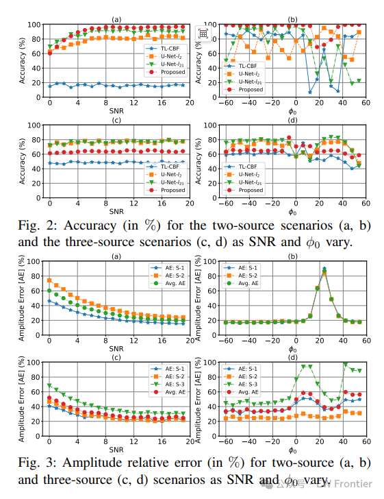
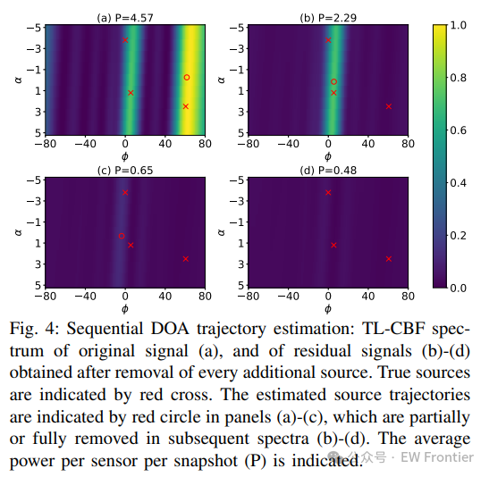

# [Meshless DOA]Using Deep Complex Networks and Residual Signal for Ordered DOA Trajectory Estimation[Purchase private message email to send Python code]

Introduction  
Direction of Arrival (DOA) estimation involves estimating the direction of multiple source signals from observations made by a sensor array. In many cases, sources are mobile, leading to changes in DOA over consecutive frames. To address this issue, recently proposed models for DOA trajectory [1] and [3] do not assume fixed sources but model the source DOA as dynamic using linear [2] and nonlinear trajectories [3]. The process of retrieving DOA through estimating trajectory parameters is known as trajectory localization.  
To estimate the trajectory parameters of DOA, traditional beamforming (CBF) [1] and its variants based on sparse Bayesian learning [4] have been developed. [6] A deep U-Net architecture based on convolutional neural networks (CNNs) has been developed, which converts low-resolution CBF output into clear spectral data. Most of these methods have the disadvantage that parameter estimation is based on grids, limiting their resolution. The gridless method [3] uses a model-based sparse signal representation to orderly identify source parameters.  
Our work aims to develop gridless and data-driven methods for DOA trajectory parameter estimation. We designed a complex deep architecture [7] to achieve gridless DOA trajectory parameter estimation. The network output is the amplitude of the single source signal (for each frame) and the trajectory parameters. By removing the contribution of this estimated source from the input data, a residual signal is obtained. This residual signal is then fed back into the same network to iteratively identify other sources until predefined stopping criteria are met, allowing the network to be reusable and independent of the number of sources to estimate.  
This approach avoids allocation ambiguity and eliminates the problem of uncertainties in output dimensions, addressing common challenges encountered when estimating multiple sources simultaneously. The idea of reusability draws inspiration from residual-based processing, a technique commonly used in matching pursuit (MP) [8], [9] and similar greedy methods. To the best of the authors' knowledge, such reusable networks have not been proposed in the literature [10].  
Article illustrations  
Conclusion  
References
This paper makes two main contributions to the DOA trajectory estimation problem. First, we developed a deep complex network to estimate source amplitudes and trajectory parameters in an ungridded manner. Second, we developed a network to estimate only the single source (the strongest) parameters, which allows for reusability of the network and enables sequential source estimation. Simulation results show that the proposed method can estimate multiple sources. Future work could explore improvements in network architecture or training strategies to mitigate error propagation and improve accuracy in such scenarios.

## Images

<!-- PAYMENT_BLOCK -->

## Get this dataset

- Payment link (Stripe): [Buy now](https://buy.stripe.com/3cs8yP7sY87d0vu9AB)
- Payment QR code: 

<!-- /PAYMENT_BLOCK -->
